# Manual de uso

Display para la báscula **Timemore Black Mirror Dot**: le da a la Dot la pantalla y los botones que no trae, y permite usarla como báscula de una cafetera **Wendougee** (Lita, Lita BA o Data-S, con E-Bar o GeeFlow). Probado con una **Lita BA**.

Tiene dos modos, como la app de Timemore: **pour-over** y **espresso**. Se cambia en *Menú → Modo* y se recuerda al apagar.

---

## 1. Primeros pasos

1. Enciende la Dot.
2. Enciende el display con el interruptor. Arriba en la pantalla aparece `BUSCANDO DOT...` y el LED parpadea en amarillo.
3. La primera vez, el display se vincula a la primera Dot que encuentre y la recuerda. A partir de ahí solo se conecta a esa.
4. Cuando conecta, el LED pasa a verde y aparece el peso.

Si la Dot se apaga o se aleja, el display la vuelve a buscar solo.

**Vincular otra Dot:** *Menú → Re-vincular Dot*, o mantén pulsado el botón **BOOT** de la placa 4 s. El display olvida la Dot actual y busca la siguiente que esté encendida.

---

## 2. Controles

Todo se maneja con el **encoder**: se gira y se pulsa. El botón BOOT de la placa admite los mismos clics.

| Acción | En el pesaje | En el menú | En el historial |
| :--- | :--- | :--- | :--- |
| **Girar** | Pour-over: **siguiente / anterior paso** (3.2). Espresso: cambiar de vista | Mover el cursor / ajustar el valor | Elegir preparación |
| **1 clic** | Pour-over: cambiar de vista (en el paso Listo: editar la receta). Espresso: empezar / cortar el shot | Entrar / confirmar | Página siguiente (gráfica, ficha, enviar a Beanconqueror) |
| **2 clics** | **Tara** (en pour-over, la del paso actual, sin perder el server) | Salir | Salir |
| **3 clics** o **mantener 1,5 s** | Abrir el menú | Cerrar el menú | Salir |
| **BOOT mantenido 4 s** | Olvidar la Dot vinculada | | |

Los clics seguidos deben llegar con menos de 0,3 s entre uno y otro.

> La tara la hace el display, no la Dot. Así la Dot no activa su bloqueo de cero (*zero-lock*), que retrasa las lecturas. Si pulsas el botón de tara de la propia Dot, el display lo detecta y anula su tara.

---

## 3. Modos

### 3.1 Pesaje (pantalla normal)

Es la pantalla al encender. El peso se ve siempre en grande y lo acompaña una de estas vistas. En pour-over se cambia de vista con **1 clic** (el giro avanza los pasos, 3.2); en espresso, girando.

| Vista | Pour-over | Espresso |
| :--- | :--- | :--- |
| **0** | **Paso guiado**: qué hacer ahora, el peso, el caudal con su medidor y la barra hacia el agua objetivo (3.2) | El shot (3.3) |
| **1 · Báscula** | Solo el peso, gigante, y el paso en curso | Solo el peso, gigante, y el cronómetro |
| **2** | **Perfil en vivo**: la gráfica del pour-over dibujándose mientras preparas (3.2) | Barra de caudal (0-5 g/s), caudal en g/s y cronómetro |
| **3** | | Curva en vivo del caudal de los últimos 16 s |

| Vista 1 · Báscula | Espresso, vista 2 · Caudal | Espresso, vista 3 · Gráfica |
| :---: | :---: | :---: |
|  |  | 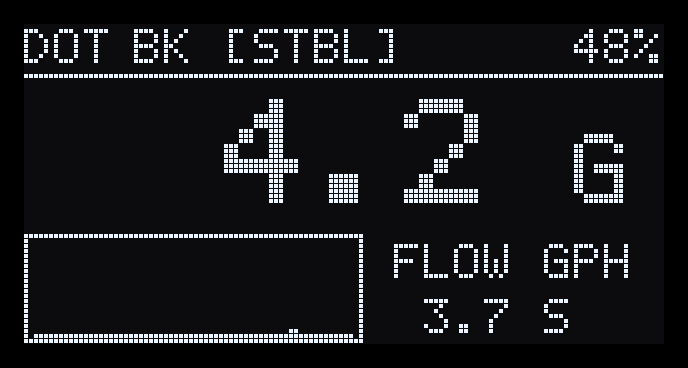 |

En la vista 1 (y en las 2 y 3 de espresso), la barra superior indica el estado de la Dot y su batería:
- `[FLOW]`: está cayendo agua;
- `[STBL]`: peso estable;
- `[MOVE]`: el peso se está moviendo.

Con el puente activo (3.5), arriba a la izquierda aparece `BK`: normal mientras se anuncia a la cafetera y en negativo cuando la cafetera está conectada.

Si el display tiene medidor de batería, su icono aparece arriba a la derecha. Se anima mientras carga y parpadea por debajo del 10 %.

### 3.2 Pour-over guiado

El pour-over va por pasos. **Girar el encoder una muesca pasa al paso siguiente** y girar hacia atrás vuelve al anterior y deshace lo que hizo. El peso nunca cambia de paso por su cuenta: si tocas el V60 o la jarra sin querer, no pasa nada. La pantalla dice siempre qué hacer y qué hará el siguiente giro (`GIRA >`).

**La receta se ajusta en el paso Listo**, a la vista: **dosis**, **ratio** (el agua objetivo es dosis × ratio), **bloom** (el agua del bloom de referencia es dosis × factor), **molienda** (el número del dial de tu molino) y **temperatura del agua**. **1 clic** resalta la dosis y **girar** la ajusta (de 0,5 en 0,5 g); cada clic pasa al siguiente: ratio (de 0,1 en 0,1, de 1:10 a 1:20), bloom (de 0,5 en 0,5, de ×1 a ×4), molienda (de 0,1 en 0,1) y agua (de 1 en 1 °C, de 70 a 100 °C), y el último guarda. **2 clics** también guardan. La receta se recuerda al apagar: el siguiente café empieza con la última.

**Para repetir un buen café**, cada pour-over guarda todo lo que lo define: dosis (la pesada), agua, ratio, bloom, molienda, temperatura del agua, granos y retención del molino, tiempos (bloom, vertidos y drawdown), caudal, yield y, si lo mides, TDS y extracción. La temperatura la pones tú (el aparato no la mide): apunta la de tu hervidor.

| Listo | Editando la receta |
| :---: | :---: |
| 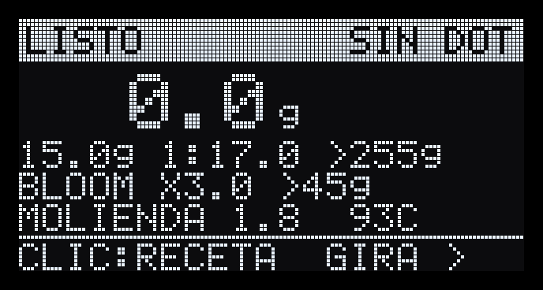 | 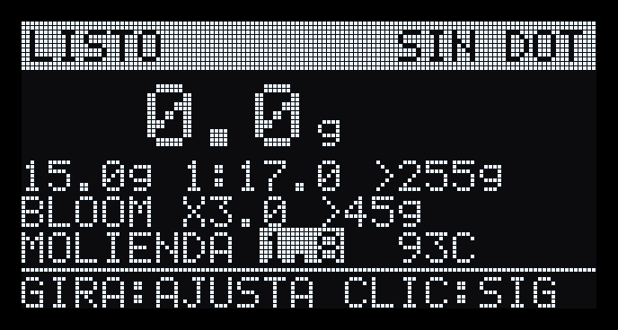 |

| Paso | Lo que haces | Lo que hace el aparato |
| :--- | :--- | :--- |
| **Listo** | Ajustas la receta si hace falta (1 clic). Pones el vaso dosificador y giras | Muestra la receta y el agua objetivo |
| **Granos** | Echas los granos en el vaso, lo quitas y mueles | Pone el vaso a 0 y pesa los granos, con una barra hacia la dosis (más la retención media del molino, si ya la conoce). Al quitar el vaso, los granos quedan fijados (`A MOLER`) |
| **Server** | Pones el server (la jarra) vacío y giras | Guarda su peso y pone la pantalla a 0 (espera a que el peso esté quieto: `ESPERA PESO QUIETO...`) |
| **V60** | Pones el V60 con el filtro (ya enjuagado) y giras | Vuelve a poner la pantalla a 0 **sin olvidar el server** |
| **Café molido** | Echas el café molido en el V60 y giras | Pesa el café: es la **dosis real**, y el agua objetivo y el bloom se recalculan con ella. Con los granos pesados, muestra la **retención del molino** (`RET +0.2`: granos − café) |
| **Bloom** | Vierte el bloom y espera | El cronómetro arranca solo con el primer chorro que deja agua. Muestra el caudal y la barra hacia el agua del bloom. Al dejar de verter cuenta el tiempo de espera (`ESPERA 0:32`), sin avisos: tú decides cuándo seguir |
| **Vertidos** | Gira al acabar el bloom y vierte el resto | Medidor de caudal, barra hacia el agua objetivo con los gramos que faltan (`-42`) y los vertidos (`B+2`: bloom y 2 tandas). LED amarillo a 10 g del objetivo y rojo al llegar |
| **Drawdown** | Gira al acabar de verter | Cuenta lo que tarda en bajar el agua |
| **Yield** | Gira cuando deja de gotear y **quita el V60** | Para el cronómetro y guarda el pour-over. Con el V60 fuera, mide la bebida (`YIELD MEDIDO`): el peso menos el server |
| **Resumen** | Míralo | Agua, ratio, yield, vertidos, tiempo de bloom, drawdown y caudal |

**Pesar es opcional.** Si no echas granos, el paso Granos se salta girando. Si pones el V60 con el café ya dentro, el paso Café molido marca 0 y también se salta. Sin pesar, la dosis es la de los granos o, si tampoco, la de la receta.

**Retención del molino.** Con un molino de dosis única, lo que entra en el V60 suele ser algo menos que los granos: lo que se queda dentro. Cada pour-over guarda los granos y el café molido, y el paso Granos muestra la **retención media** de los guardados (`RETENCION MEDIA +0.2g`) y la suma a la dosis de la barra, para que en el V60 entre la dosis de la receta. Puede salir negativa si el molino suelta café de la vez anterior.

Desde el resumen, **girar** vuelve a Listo para el siguiente café. Si tienes un DiFluid R2 vinculado, antes abre la medida del TDS de este pour-over.

| Granos | Server | V60 |
| :---: | :---: | :---: |
| 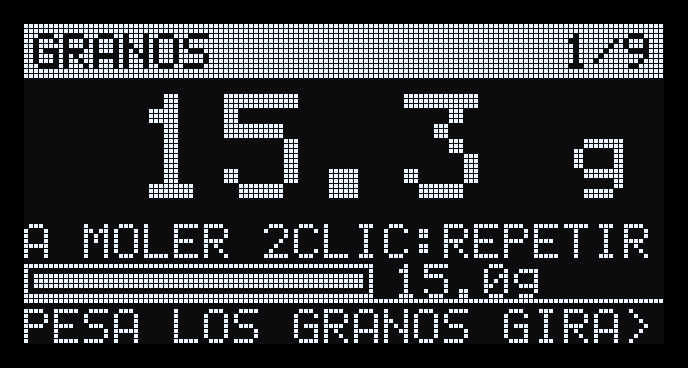 | 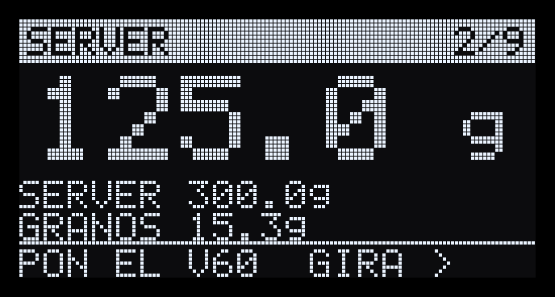 | 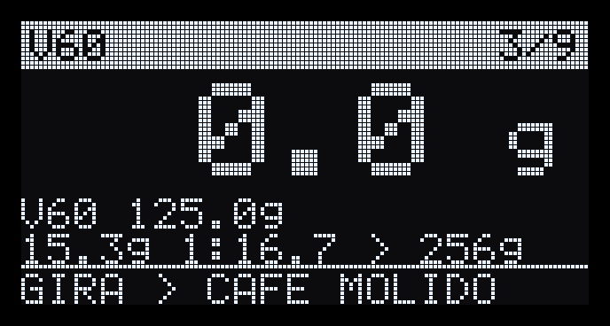 |
| **Café molido** | **Bloom: vertiendo** | |
| 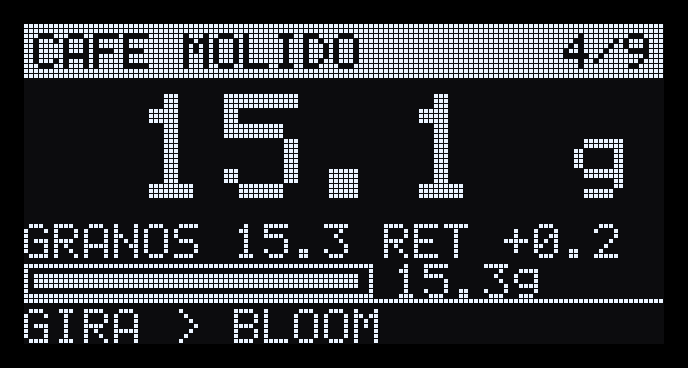 | 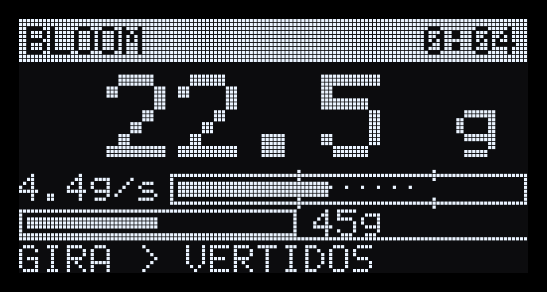 | |
| **Bloom: espera** | **Vertidos** | **Yield** |
| 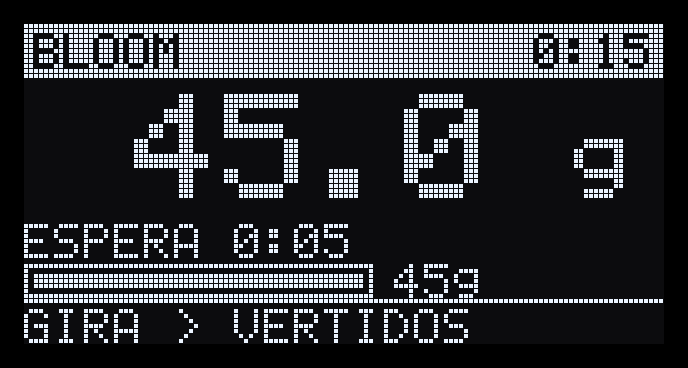 | 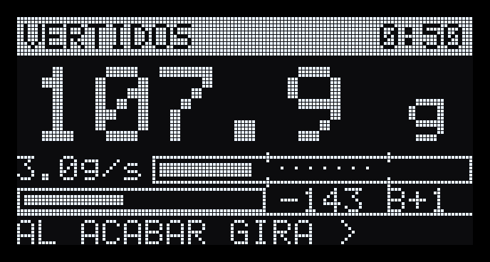 | 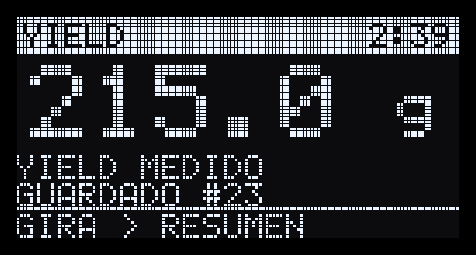 |
| **Resumen** | **Perfil en vivo (vista 2)** | **Menú** |
| 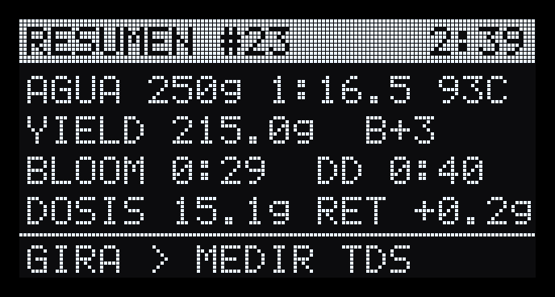 | 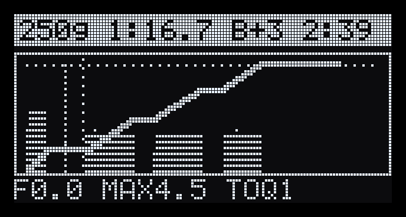 | 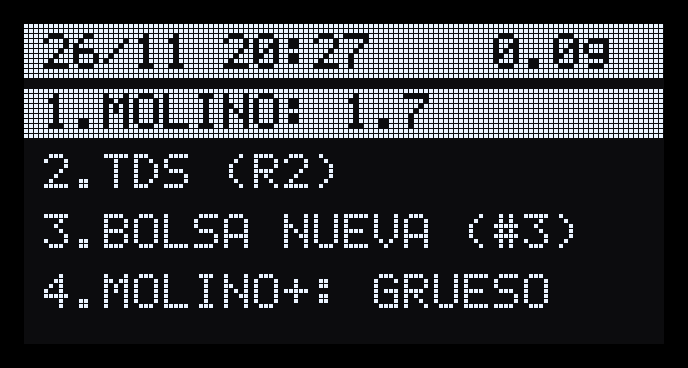 |

*Capturas de la demostración `v` del monitor serie ([TECNICO.md](./docs/TECNICO.md#5-monitor-serie-115200)): 15,3 g de granos, 15,1 g de café molido, 250 g de agua, bloom de 45 g y un toque de la tetera durante la espera.*

**El medidor de caudal** va de 0 a 10 g/s y tiene tres zonas: lento, la **zona ideal de 3,5 a 7,5 g/s** (entre las dos muescas) y demasiado rápido (la barra sale rayada).

**Toques de la tetera:** si el pico de la tetera golpea el filtro, el peso sube y vuelve a donde estaba. El aparato no lo cuenta como vertido ni usa su caudal para el máximo; el perfil cuenta esos toques aparte (`TAP 1`).

**Perfil en vivo** (vista 2): la gráfica del historial, dibujándose. La línea es el agua y las barras, el caudal de cada vertido. La línea punteada horizontal es el agua objetivo y la vertical, el fin del bloom. Empieza con 3 minutos de ancho y se estira si el café tarda más.

**2 clics** hacen la tara del paso en curso sin perder el server. En Bloom, Vertidos o Drawdown, además, vuelven a empezar los vertidos (de nuevo en Bloom).

**Historial de pour-overs:** *Menú → Pour-overs (n/10)*. Se guardan las **10 últimas** preparaciones; se conservan al apagar.

- **Gira** para elegir una. La cabecera muestra el número, el agua, el ratio y la duración.
- **1 clic** pasa a la página siguiente: la **gráfica** (la misma que el perfil en vivo), la **ficha** (agua, o granos y retención del molino si se pesaron; dosis y ratio; molienda y temperatura del agua; y vertidos), el gráfico de control si tiene TDS y, al final, **Enviar a Beanconqueror**.
- **2 o 3 clics** para salir.

**Enviar a Beanconqueror:** en la última página del historial, **1 clic**. El aparato apaga el Bluetooth (con el café hecho, la Dot no hace falta), se conecta a tu WiFi y muestra un **código QR**.

1. Escanéalo con la cámara del móvil donde tienes Beanconqueror. Se abre una página del aparato con tus cafés guardados: el elegido y los que aún no enviaste ya vienen marcados.
2. La primera vez, abre *Nombres en tu Beanconqueror* y escribe el método, el molino y el café **como se llaman en tu app**. El móvil los recuerda.
3. Toca **Enviar a Beanconqueror**. La app se abre e importa los cafés: dosis (el café molido pesado), agua, bebida (el yield medido), tiempo, bloom, molienda, temperatura del agua, fecha y la curva de peso. El **TDS y la extracción**, los granos y la retención del molino van en la nota, porque la importación de Beanconqueror aún no tiene campo para ellos. Los cafés quedan marcados como **ENVIADO**.
4. **1 clic** en el aparato para terminar (o se cierra solo a los 3 minutos sin uso). Vuelve el Bluetooth y la Dot se reconecta sola.

| 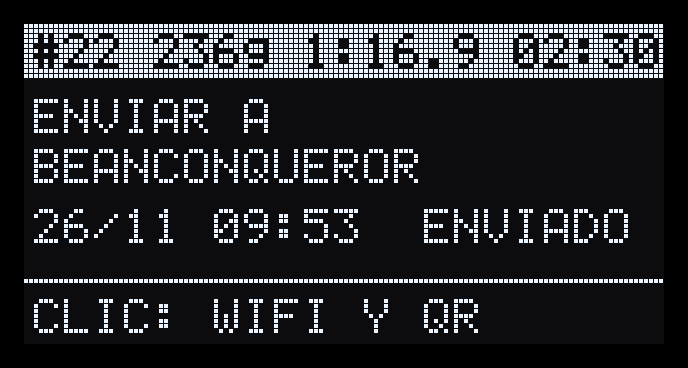 | 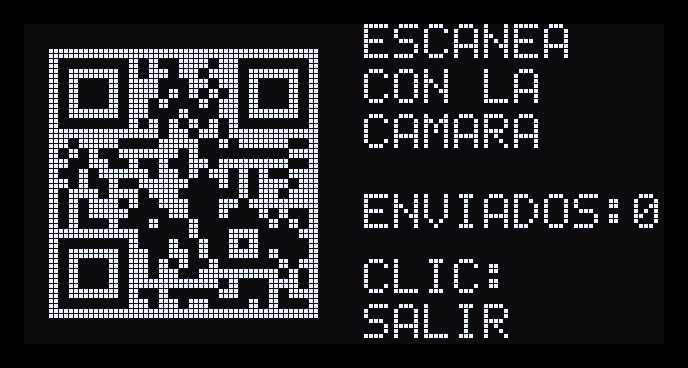 | 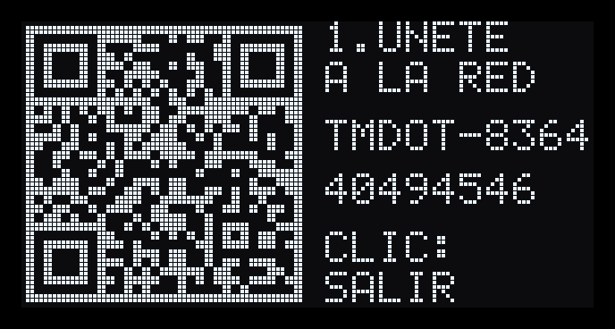 |
| :---: | :---: | :---: |
| Última página del historial | QR de la página (en tu WiFi) | Red propia: QR para unirse |

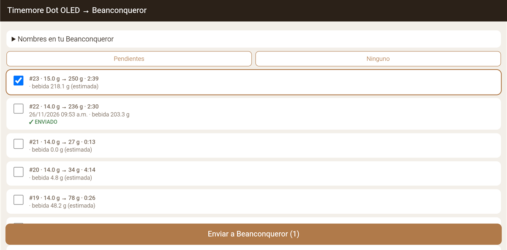

Si el aparato no tiene WiFi guardado (se pone en la [página de actualización](https://jcallano.github.io/Timemore_Dot_OLED/ota/)) o no la encuentra, crea **su propia red**: el primer QR sirve para unirse a ella (también se ven el nombre y la clave) y, al unirse el móvil, sale el QR de la página. Hace falta Beanconqueror 8.8.2 o posterior.

**Trazas:** de cada preparación guiada se guarda también una traza con todas las lecturas de la báscula (10 por segundo) y lo que pasó (pasos, vertidos, toques, yield). Se guardan las 8 últimas y se descargan por USB para analizarlas (ver [TECNICO.md](./docs/TECNICO.md#83-trazas)).

### 3.3 Espresso

*Menú → Modo: Espresso*. La vista principal pasa a ser la del shot:

```text
1.8G/S    18.0>36.0G 28S     caudal | receta: dosis > peso objetivo, tiempo objetivo
  32.8 G                     peso en la taza
[################   |]       progreso hacia el objetivo; la marca de abajo es el punto de corte
1:1.82     | CASI            ratio actual | estado
PI 8.0S    | 26.6 S          preinfusión | cronómetro del shot
```

**La receta** se ajusta en el menú (1 clic para editar, girar, 1 clic para guardar):
- **Dosis**: café molido, de 0,1 en 0,1 g.
- **Ratio**: `1:2.0` por defecto. El menú muestra también el peso objetivo resultante (dosis × ratio), por ejemplo `RATIO 1:2.0=36.0G`.
- **Tiempo**: el tiempo objetivo del shot, como referencia.

**Un shot:**
1. Pon la taza sobre la Dot y haz **2 clics** (tara). La pantalla indica `LISTO`.
2. **1 clic al pulsar el botón de la cafetera.** El cronómetro arranca y el aparato espera la primera gota (`PI ...`). Cuando cae, muestra la **preinfusión** (`PI 8.0S`): el tiempo desde que pulsaste hasta la primera gota. Es el dato más útil para ajustar la molienda.
   - Si no haces clic, el cronómetro arranca solo con la primera gota (entonces no hay preinfusión: `PI --`).
3. **Sigue la barra.** Unos gramos antes del objetivo aparece `CASI` y el LED se pone **amarillo**; al llegar al punto de corte, `CORTA!` y el LED **rojo**: corta la cafetera.
4. **1 clic al cortar.** El aparato espera 3 s (`GOTEO`) para medir lo que sigue cayendo y guarda el shot. Si no haces clic, el shot termina solo cuando deja de caer café.
5. Aparece `SHOT #N GUARDADO!` con la bebida, el ratio, el tiempo y la preinfusión.

**El punto de corte aprende:** es el peso objetivo menos lo que suele seguir cayendo después de cortar. El aparato lo mide en cada shot cortado a mano o por la cafetera y lo va ajustando. Así, si cortas cuando dice `CORTA!`, la taza acaba en el peso objetivo.


*Un espresso de 18 g a 36 g en la pantalla del aparato, acelerado 2 veces: preinfusión de 8 s, aviso `CASI`, corte, goteo de 1,9 g y resumen.*

**Historial de shots:** *Menú → Shots (n/10)*. Los **10 últimos** shots, aparte de los pour-overs; se conservan al apagar.
- La **gráfica** muestra el peso (línea), el caudal (barras), el peso objetivo (línea punteada horizontal) y la primera gota (línea punteada vertical).
- La **ficha** muestra la bebida y el objetivo, la dosis y el ratio, el tiempo y la preinfusión, y cómo terminó: `CORTE:MANUAL +1.9G` (con lo que cayó después de cortar), `CORTE:CAFETERA` o `FIN AUTOMATICO`.

| En marcha (`CASI`) | Goteo tras cortar | Shot guardado |
| :---: | :---: | :---: |
| 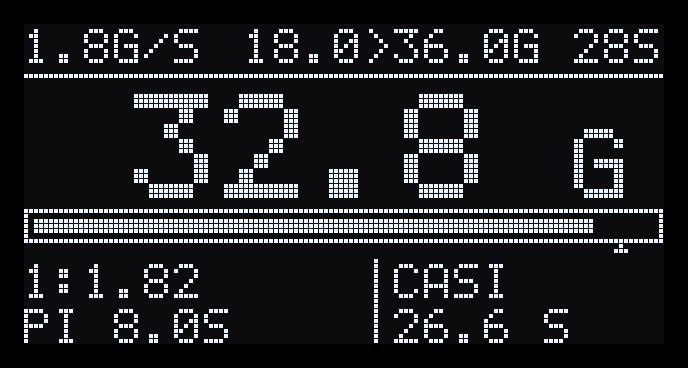 | 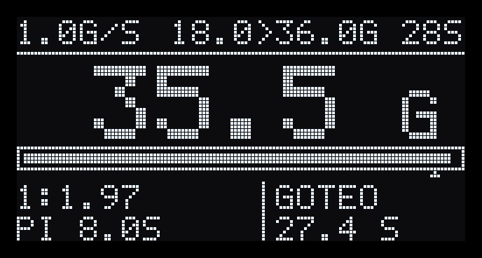 |  |
| **Gráfica** | **Ficha** | |
|  |  | |

> **Con la Wendougee** (puente activo, 3.5), es la cafetera la que arranca, hace la tara y corta el shot. El aparato también guarda esos shots en el historial, en cualquier modo, con la preinfusión medida desde que la cafetera arranca.

### 3.4 Elegir el modo

| | Pour-over | Espresso |
| :--- | :--- | :--- |
| Vista principal | Paso guiado: caudal con zona ideal, progreso al agua objetivo, vertidos | Receta, progreso al objetivo, ratio, preinfusión, cronómetro |
| Girar | Siguiente / anterior paso | Cambiar de vista |
| 1 clic | Cambiar de vista | Empezar / cortar el shot |
| Arranque automático | Con el primer chorro, en el paso Bloom | Con la primera gota, tras una tara |
| Historial | Pour-overs (bloom, vertidos, yield) | Shots (preinfusión, corte y goteo) |

### 3.5 Puente con la Wendougee

Las Wendougee Lita, Lita BA y Data-S con E-Bar o GeeFlow solo aceptan básculas BooKoo. Con el puente activo, el display se presenta ante la cafetera como una báscula **`BOOKOO_SC_U XXXXXX`** y le pasa el peso de la Dot en tiempo real. Sigue conectado a la Dot a la vez.

**Activarlo (una sola vez):**
1. *Menú → Puente BooKoo: ON*. El Bluetooth se reinicia y la Dot vuelve a conectarse en unos 2 s. El ajuste se recuerda.
2. En la cafetera: *Machine Settings → Connectivity → Smart Scale → ON → Scan* y elige `BOOKOO_SC_U XXXXXX`.

**Durante el uso:**
- Cuando la cafetera se conecta, el LED se pone **magenta** y la pantalla pasa a la **vista de puente**.
- La cafetera manda en el cronómetro y en la tara: al empezar el shot hace tara y arranca el cronómetro, y lo para al llegar al peso objetivo. La pantalla y la cafetera ven siempre el mismo peso.
- Cada shot se guarda en el **historial de shots** (3.3), con la preinfusión y lo que cayó después del corte. No va al historial de pour-overs.
- Mientras la cafetera está conectada, el display **no entra en reposo**.

**Vista de puente** (se puede volver a ella girando el encoder; es la quinta vista mientras la cafetera está conectada):

```text
M15MS -58 D15MS -61     enlace con la Máquina y con la Dot: intervalo y señal
  36.4 G       2.1G/S   peso y caudal
               >24.3S   cronómetro ('>' = en marcha)
TX10.0 AGE  4/12    ?1  envíos por segundo, antigüedad del peso, comandos raros
STOP   36.2 +1.4   3S   último STOP: peso al parar y rebase
T+START            28S  comandos anteriores de la cafetera
```

- **TX** debería rondar 10 (un peso por cada lectura de la Dot).
- **AGE** es la antigüedad, en ms, del peso que recibe la cafetera: la del último envío y la máxima del último segundo. Si pasa de 150 ms la línea se invierte: la Dot se ha saltado lecturas o la señal es mala.
- **Rebase**: lo que sigue cayendo en la taza en los 3 s siguientes al `STOP`. Sirve para ajustar el peso objetivo en la cafetera.
- **`?N`**: comandos que la cafetera envió y el display no reconoció. Lo normal es que no aparezca.

Para dejar de usarlo: *Menú → Puente BooKoo: OFF*.

### 3.6 Menú

Se abre con **3 clics** (o manteniendo pulsado 1,5 s). Gira para moverte y haz 1 clic para elegir. Las opciones cambian con el modo:

| Pour-over | Espresso |
| :---: | :---: |
|  | 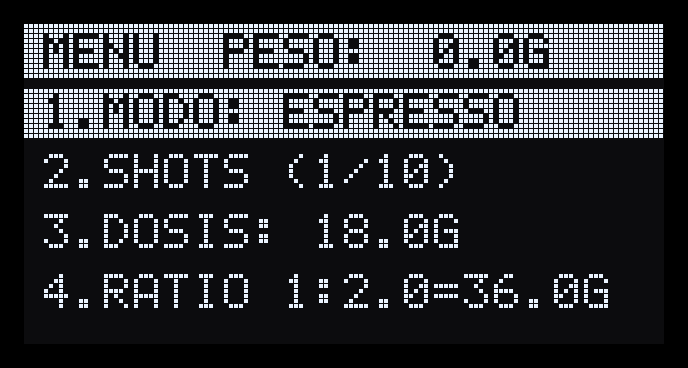 |

| Opción | Modo | Qué hace |
| :--- | :--- | :--- |
| **Dosis** | espresso | 5-30 g, de 0,1 en 0,1 g. La del pour-over se ajusta en su paso Listo (3.2) |
| **Ratio** | espresso | 1:1,0 a 1:4,0; muestra el peso objetivo (3.3) |
| **Tiempo** | espresso | Tiempo objetivo del shot, 10-90 s |
| **Molino** | espresso | El número del dial de tu molino para espresso. La del pour-over se pone en su paso Listo (3.2) |
| **TDS (R2)** | los dos | Medir el TDS de un café con el DiFluid R2 |
| **Bolsa nueva** | los dos | Empieza otra bolsa de café: la molienda de la anterior deja de servir de referencia |
| **Molino+** | los dos | Hacia dónde muele más grueso tu molino al subir el número |
| **Tu gusto** | los dos | Lo que la red neuronal ha aprendido de tus valoraciones |
| **Pour-overs (n/10)** / **Shots (n/10)** | según el modo | Abre el historial (3.2 / 3.3) |
| **Modo** | los dos | Pour-over ↔ espresso (3.4). El cursor se queda en esta opción |
| **Brillo** | los dos | Bajo / medio / alto |
| **Idioma** | los dos | Inglés o español |
| **Puente BooKoo: ON/OFF** | los dos | Puente con la Wendougee (3.5) |
| **Re-vincular Dot** | los dos | Olvida la Dot y busca otra |
| **Actualizar (BLE)** | los dos | Actualizar el firmware por Bluetooth (3.7) |
| **Apagar (sleep)** | los dos | Reposo inmediato (3.8) |
| **Salir** | los dos | Vuelve al pesaje |

Arriba va lo de cada día (la receta, el historial y el modo) y abajo los ajustes del aparato.

### 3.7 Actualización por Bluetooth

El firmware se actualiza desde el navegador, sin cables ni programas.

1. Descarga el archivo **`firmware.ino.bin`** de la [última versión](https://github.com/jcallano/Timemore_Dot_OLED/releases/latest).
2. En el aparato: *Menú → Actualizar (BLE)*. El LED se pone magenta y la pantalla muestra un **PIN** de 6 cifras, distinto cada vez.
3. Abre la página **[jcallano.github.io/Timemore_Dot_OLED/ota](https://jcallano.github.io/Timemore_Dot_OLED/ota/)** con **Chrome o Edge** en el ordenador o con **Chrome en Android**. En iPhone, usa la app **Bluefy**.
4. Elige el archivo, escribe el PIN y pulsa **Actualizar**. En la lista de Bluetooth elige **`TMDot-OTA`**.
5. La pantalla del aparato y la página muestran el progreso. Tarda menos de un minuto. Al terminar, el aparato comprueba el firmware y se reinicia con la versión nueva.

Si algo falla a mitad, no se instala nada: el aparato sigue con el firmware anterior. Solo quien ve el PIN en la pantalla puede actualizarlo.

**1 clic** en el aparato cancela. Sin actividad, sale solo a los 5 minutos.

### 3.8 Ahorro de energía

| Situación | Qué pasa |
| :--- | :--- |
| 2 min sin actividad | La pantalla se atenúa |
| 10 min sin actividad, o *Menú → Apagar* | **Reposo**: pantalla y Bluetooth apagados. Despierta al girar o pulsar el encoder, o con BOOT, y vuelve a conectar con la Dot. No ocurre mientras la Wendougee está conectada ni mientras está enchufado a un ordenador por USB |
| Batería por debajo de 3,25 V (solo con medidor de batería) | Muestra `BATERIA BAJA / CARGA POR USB-C` y se apaga. Para volver a encenderlo, cárgalo y pulsa el encoder |

Cuentan como actividad tocar el encoder, cualquier cambio de peso en la Dot y tener el cronómetro en marcha.

---

## 4. LED de estado

| Color | Significado |
| :--- | :--- |
| Amarillo intermitente | Buscando o conectando con la Dot |
| Rojo intermitente | Sin báscula |
| Verde | Dot conectada, sin vertido |
| Cian | Vertido en curso |
| Amarillo fijo | Espresso: cerca del punto de corte (`CASI`). Pour-over: a 10 g del agua objetivo |
| Rojo fijo | Espresso: punto de corte alcanzado, corta ya (`CORTA!`). Pour-over: agua objetivo alcanzada |
| Magenta | Wendougee conectada por el puente (o actualizando el firmware, con su pantalla) |
| Azul fijo | Enviando a Beanconqueror por WiFi (con el QR en pantalla) |
| Destello blanco | Acción confirmada (clic, tara…) |

---

## 5. Problemas frecuentes

| Problema | Qué hacer |
| :--- | :--- |
| Se queda en `BUSCANDO DOT...` | Comprueba que la Dot está encendida y cerca, y que no está conectada a la app del móvil (solo admite una conexión). Si la Dot llegó a conectar pero no mandó peso (recién encendida u ocupada con otra app), el display la aparta **1 minuto** y vuelve a intentarlo solo; *Re-vincular Dot* lo intenta al momento. Si es otra Dot, usa *Re-vincular Dot* |
| El peso llega con retraso | No debería ocurrir: el display mantiene vacía la cola de la Dot. Si pasa, apaga y enciende la Dot. Para diagnosticarlo, ver [`COLA_DOT_MTU.md`](./docs/COLA_DOT_MTU.md) |
| La cafetera no encuentra `BOOKOO_SC_U` | Comprueba que el puente está en ON (`BK` arriba en las vistas 1-3) y que el móvil no tiene abierta una app de básculas BooKoo |
| La línea `AGE` sale invertida a menudo | Acerca el display a la Dot y a la cafetera; aléjalo de routers y microondas |
| La Dot se apaga sola | Revisa su batería (en la barra superior de las vistas 1-3). El display le envía un aviso cada 25 s para que no se apague mientras está conectada |
| En espresso no marca la preinfusión (`PI --`) | El shot arrancó solo con la primera gota. Haz 1 clic al pulsar el botón de la cafetera |
| El shot no arranca solo | Haz antes **2 clics** (tara): el arranque con la primera gota solo se arma tras una tara, para que poner la taza no lo dispare |
