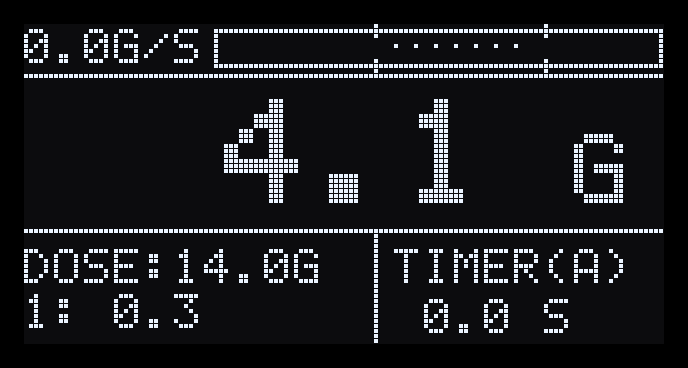
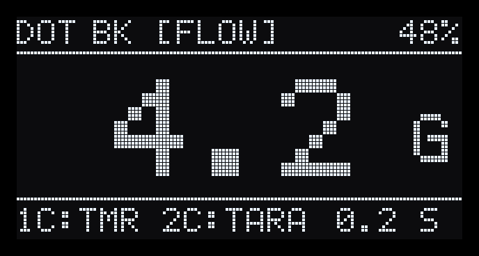
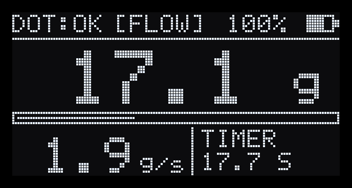
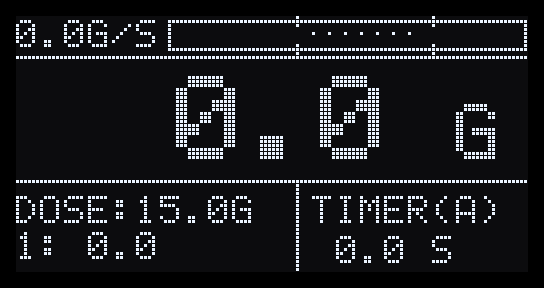
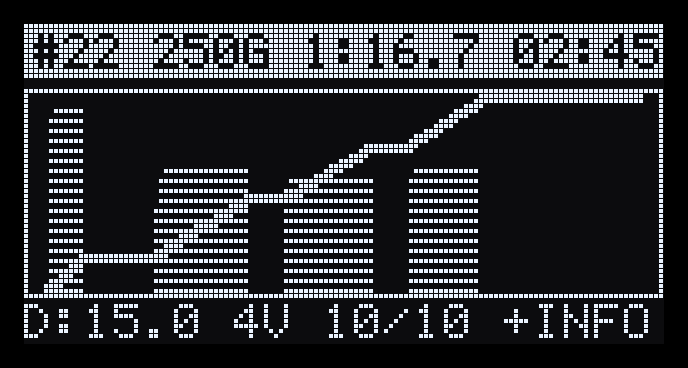
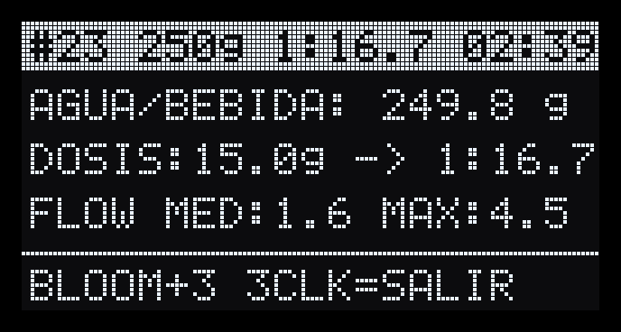
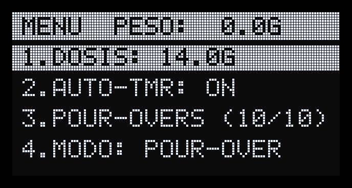

# Manual de uso

Display para la báscula **Timemore Black Mirror Dot**: le da a la Dot la pantalla y los botones que no trae, y permite usarla como báscula de una cafetera **Wendougee** (Lita, Lita BA o Data-S, con E-Bar o GeeFlow). Probado con una **Lita BA**.

---

## 1. Primeros pasos

1. Enciende la Dot.
2. Enciende el display con el interruptor. Arriba en la pantalla aparece `BUSCANDO DOT...` y el LED parpadea en amarillo.
3. La primera vez, el display se vincula a la primera Dot que encuentre y la recuerda. A partir de ahí solo se conecta a esa.
4. Cuando conecta, el LED pasa a verde y aparece el peso.

Si la Dot se apaga o se aleja, el display la vuelve a buscar solo.

**Vincular otra Dot:** *Menú → 6. Re-vincular Dot*, o mantén pulsado el botón **BOOT** de la placa 4 s. El display olvida la Dot actual y busca la siguiente que esté encendida.

---

## 2. Controles

Todo se maneja con el **encoder**: se gira y se pulsa. El botón BOOT de la placa admite los mismos clics.

| Acción | En el pesaje | En el menú | En el historial |
| :--- | :--- | :--- | :--- |
| **Girar** | Cambiar de vista | Mover el cursor / ajustar la dosis | Elegir preparación |
| **1 clic** | Cronómetro: iniciar / pausar | Entrar / confirmar | Gráfica ↔ ficha |
| **2 clics** | **Tara** y cronómetro a 0 | Salir | Salir |
| **3 clics** o **mantener 1,5 s** | Abrir el menú | Cerrar el menú | Salir |
| **BOOT mantenido 4 s** | Olvidar la Dot vinculada | | |

Los clics seguidos deben llegar con menos de 0,3 s entre uno y otro.

> La tara la hace el display, no la Dot. Así la Dot no activa su bloqueo de cero (*zero-lock*), que retrasa las lecturas. Si pulsas el botón de tara de la propia Dot, el display lo detecta y anula su tara.

---

## 3. Modos

### 3.1 Pesaje (pantalla normal)

Es la pantalla al encender. El peso se ve siempre en grande; al girar el encoder se cambia lo que lo acompaña:

| Vista | Qué muestra | Para qué |
| :--- | :--- | :--- |
| **0 · Principal** | Caudal en g/s con un medidor de 0 a 10 g/s, dosis (`DOSE`), ratio `1:X` y cronómetro | Pour-over. El medidor marca la **zona ideal de 3,5 a 7,5 g/s**; por encima, la barra sale rayada (vertido demasiado rápido) |
| **1 · Báscula** | Solo el peso, gigante, y el cronómetro | Pesar café o agua sin distracciones |
| **2 · Caudal** | Barra de caudal (0-5 g/s), caudal en g/s y cronómetro | Controlar el ritmo de vertido |
| **3 · Gráfica** | Curva en vivo del caudal de los últimos 16 s y cronómetro | Ver la regularidad de los vertidos |

| Vista 0 · Principal | Vista 1 · Báscula |
| :---: | :---: |
|  |  |
| **Vista 2 · Caudal** | **Vista 3 · Gráfica** |
|  |  |

*Capturas reales de la pantalla, con la báscula en reposo.*

En las vistas 1 a 3, la barra superior indica el estado de la Dot y su batería:
- `[FLOW]`: está cayendo agua;
- `[STBL]`: peso estable;
- `[MOVE]`: el peso se está moviendo.

Con el puente activo (3.4), arriba a la izquierda aparece `BK`: normal mientras se anuncia a la cafetera y en negativo cuando la cafetera está conectada.

Si el display tiene medidor de batería, su icono aparece arriba a la derecha. Se anima mientras carga y parpadea por debajo del 10 %.

### 3.2 Preparación de pour-over (Auto-Brew)

El cronómetro puede arrancar y parar solo. Activa o desactiva esta función en *Menú → 2. Auto-Tmr*.

1. Pon el dripper y la jarra sobre la Dot y haz **2 clics**: tara a 0,0 g y cronómetro a 0. El cronómetro aparece como `TIMER(A)`: está armado.
2. Ajusta la dosis de café en *Menú → 3. Dosis* si ha cambiado. El ratio `1:X` se calcula con ella.
3. **Vierte.** El cronómetro arranca solo cuando el peso pasa de 0,5 g y el caudal de 0,4 g/s.
4. **Para terminar:**
   - **1 clic** detiene el cronómetro y guarda la preparación;
   - o, con Auto-Brew, **retira el dripper o la jarra**: si el peso se queda 5 s por debajo del 70 % del máximo, el cronómetro se para en el momento de la caída y se guarda. El bloom y las pausas entre vertidos no lo disparan.
5. Aparece `POUR #N GUARDADO!` con el peso final, el ratio y el tiempo.



*Un V60 de principio a fin en la pantalla del aparato, acelerado 10 veces.*

Sin Auto-Brew, el cronómetro se maneja a mano: 1 clic para iniciar y 1 clic para parar y guardar. Si reanudas y vuelves a parar, se actualiza la misma preparación.

### 3.3 Historial de preparaciones

*Menú → 1. Pour-overs (n/10)*. Se guardan las **10 últimas** preparaciones; se conservan al apagar.

- **Gira** para elegir una. La cabecera muestra el número, el peso final, el ratio y la duración.
- **1 clic** alterna entre:
  - la **gráfica**: línea del peso acumulado y barras de caudal, con la dosis y el número de vertidos;
  - la **ficha**: agua, dosis y ratio, caudal medio y máximo, y número de vertidos.
- Si el primer vertido es pequeño (hasta un tercio del total) y le sigue una espera de 15 s o más, el aparato lo reconoce como **bloom**: la ficha indica `BLOOM+3` (bloom y tres vertidos) y la gráfica `B+3`. Si no, indica solo el número de vertidos (`VERTIDOS:4`, `4V`).
- **2 o 3 clics** para salir.

| Gráfica | Ficha |
| :---: | :---: |
|  |  |

*Ejemplo: 15 g de café y 250 g de agua (1:16,7) en 2:45, con un bloom de 45 g y 30 s de espera, y tres vertidos hasta 120, 190 y 250 g. En la gráfica, la línea es el peso acumulado y las barras, el caudal de cada vertido. El aparato reconoce el bloom y lo indica como `BLOOM+3`.*

### 3.4 Puente con la Wendougee

Las Wendougee Lita, Lita BA y Data-S con E-Bar o GeeFlow solo aceptan básculas BooKoo. Con el puente activo, el display se presenta ante la cafetera como una báscula **`BOOKOO_SC_U XXXXXX`** y le pasa el peso de la Dot en tiempo real. Sigue conectado a la Dot a la vez.

**Activarlo (una sola vez):**
1. *Menú → 5. Puente BooKoo: ON*. El Bluetooth se reinicia y la Dot vuelve a conectarse en unos 2 s. El ajuste se recuerda.
2. En la cafetera: *Machine Settings → Connectivity → Smart Scale → ON → Scan* y elige `BOOKOO_SC_U XXXXXX`.

**Durante el uso:**
- Cuando la cafetera se conecta, el LED se pone **magenta** y la pantalla pasa a la **vista de puente**.
- La cafetera manda en el cronómetro y en la tara: al empezar el shot hace tara y arranca el cronómetro, y lo para al llegar al peso objetivo. La pantalla y la cafetera ven siempre el mismo peso.
- Los shots de espresso **no** se guardan en el historial de pour-overs.
- Mientras la cafetera está conectada, el display **no entra en reposo**.

**Vista de puente** (se puede volver a ella girando el encoder; es la quinta vista mientras la cafetera está conectada):

```text
M15MS -58 D15MS -61     enlace con la Máquina y con la Dot: intervalo y señal
  36.4 G       2.1G/S   peso y caudal
               >24.3S   cronómetro ('>' = en marcha)
TX10.0 AGE  4/12    ?1  envíos por segundo, antigüedad del peso, comandos raros
STOP   36.2 +1.4   3S   último STOP: peso al parar y rebase
T+START            28S  comandos anteriores de la cafetera
```

- **TX** debería rondar 10 (un peso por cada lectura de la Dot).
- **AGE** es la antigüedad, en ms, del peso que recibe la cafetera: la del último envío y la máxima del último segundo. Si pasa de 150 ms la línea se invierte: la Dot se ha saltado lecturas o la señal es mala.
- **Rebase**: lo que sigue cayendo en la taza en los 3 s siguientes al `STOP`. Sirve para ajustar el peso objetivo en la cafetera.
- **`?N`**: comandos que la cafetera envió y el display no reconoció. Lo normal es que no aparezca.

Para dejar de usarlo: *Menú → 5. Puente BooKoo: OFF*.

### 3.5 Menú

Se abre con **3 clics** (o manteniendo pulsado 1,5 s). Gira para moverte y haz 1 clic para elegir.



| Opción | Qué hace |
| :--- | :--- |
| **1. Pour-overs (n/10)** | Abre el historial (3.3) |
| **2. Auto-Tmr: ON/OFF** | Arranque y parada automáticos del cronómetro (3.2) |
| **3. Dosis** | 1 clic para editar, girar para ajustar (5-60 g, de 0,5 en 0,5 g), 1 clic para guardar |
| **4. Brillo** | Bajo / medio / alto |
| **5. Puente BooKoo: ON/OFF** | Puente con la Wendougee (3.4) |
| **6. Re-vincular Dot** | Olvida la Dot y busca otra |
| **7. Actualizar (BLE)** | Actualizar el firmware por Bluetooth (3.6) |
| **8. Apagar (sleep)** | Reposo inmediato (3.7) |
| **9. Salir** | Vuelve al pesaje |

### 3.6 Actualización por Bluetooth

El firmware se actualiza desde el navegador, sin cables ni programas.

1. Descarga el archivo **`firmware.ino.bin`** de la [última versión](https://github.com/jcallano/Timemore_Dot_OLED/releases/latest).
2. En el aparato: *Menú → 7. Actualizar (BLE)*. El LED se pone magenta y la pantalla muestra un **PIN** de 6 cifras, distinto cada vez.
3. Abre la página **[jcallano.github.io/Timemore_Dot_OLED/ota](https://jcallano.github.io/Timemore_Dot_OLED/ota/)** con **Chrome o Edge** en el ordenador o con **Chrome en Android**. En iPhone, usa la app **Bluefy**.
4. Elige el archivo, escribe el PIN y pulsa **Actualizar**. En la lista de Bluetooth elige **`TMDot-OTA`**.
5. La pantalla del aparato y la página muestran el progreso. Tarda menos de un minuto. Al terminar, el aparato comprueba el firmware y se reinicia con la versión nueva.

Si algo falla a mitad, no se instala nada: el aparato sigue con el firmware anterior. Solo quien ve el PIN en la pantalla puede actualizarlo.

**1 clic** en el aparato cancela. Sin actividad, sale solo a los 5 minutos.

### 3.7 Ahorro de energía

| Situación | Qué pasa |
| :--- | :--- |
| 2 min sin actividad | La pantalla se atenúa |
| 10 min sin actividad, o *Menú → 8* | **Reposo**: pantalla y Bluetooth apagados. Despierta al girar o pulsar el encoder, o con BOOT, y vuelve a conectar con la Dot. No ocurre mientras la Wendougee está conectada ni mientras está enchufado a un ordenador por USB |
| Batería por debajo de 3,25 V (solo con medidor de batería) | Muestra `BATERIA BAJA / CARGA POR USB-C` y se apaga. Para volver a encenderlo, cárgalo y pulsa el encoder |

Cuentan como actividad tocar el encoder, cualquier cambio de peso en la Dot y tener el cronómetro en marcha.

---

## 4. LED de estado

| Color | Significado |
| :--- | :--- |
| Amarillo intermitente | Buscando o conectando con la Dot |
| Rojo intermitente | Sin báscula |
| Verde | Dot conectada, sin vertido |
| Cian | Vertido en curso |
| Magenta | Wendougee conectada por el puente (o actualizando el firmware, con su pantalla) |
| Destello blanco | Acción confirmada (clic, tara…) |

---

## 5. Problemas frecuentes

| Problema | Qué hacer |
| :--- | :--- |
| Se queda en `BUSCANDO DOT...` | Comprueba que la Dot está encendida y cerca, y que no está conectada a la app del móvil (solo admite una conexión). Si es otra Dot, usa *Re-vincular Dot* |
| El peso llega con retraso | No debería ocurrir: el display mantiene vacía la cola de la Dot. Si pasa, apaga y enciende la Dot. Para diagnosticarlo, ver [`COLA_DOT_MTU.md`](./docs/COLA_DOT_MTU.md) |
| La cafetera no encuentra `BOOKOO_SC_U` | Comprueba que el puente está en ON (`bk` arriba en las vistas 1-3) y que el móvil no tiene abierta una app de básculas BooKoo |
| La línea `AGE` sale invertida a menudo | Acerca el display a la Dot y a la cafetera; aléjalo de routers y microondas |
| La Dot se apaga sola | Revisa su batería (en la barra superior de las vistas 1-3). El display le envía un aviso cada 25 s para que no se apague mientras está conectada |
