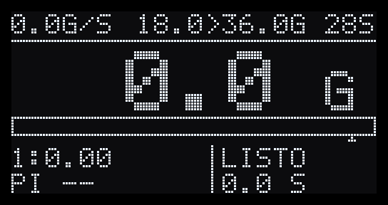
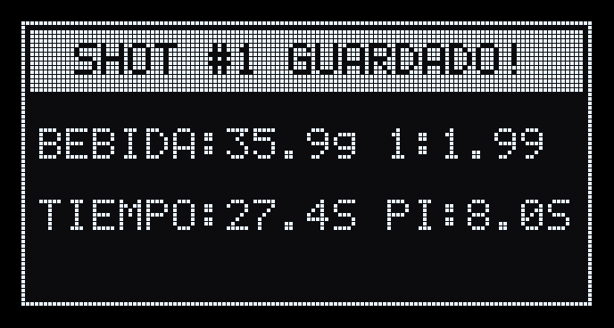
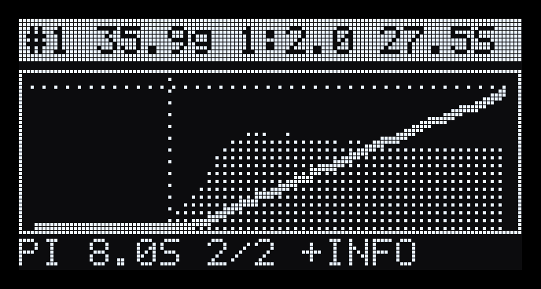
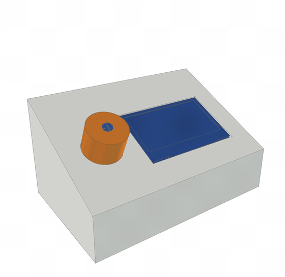

# Timemore Black Mirror Dot con pantalla, botones y conexión a la cafetera Wendougee

La **Timemore Black Mirror Dot** es una báscula de café preciosa y precisa, pero tiene dos pegas: no muestra el caudal ni tiene botones de cronómetro (todo va por la app del móvil), y las cafeteras **Wendougee** no la reconocen como báscula.

Este proyecto es un **pequeño aparato que se pone junto a la báscula** y resuelve las dos cosas:

1. **Le da a la Dot una pantalla y un mando.** Ves el peso, el caudal, el ratio y el tiempo sin sacar el móvil, y guarda tus últimas preparaciones de pour-over.
2. **Hace que la Wendougee acepte la Dot** como báscula, para preparar el espresso por peso.

Es un proyecto abierto: piezas fáciles de conseguir, una caja para imprimir en 3D y el programa listo para cargar.

## ¿Se puede usar la Timemore Dot con la Wendougee?

**Sí, con este aparato** (probado con una **Wendougee Lita BA**). Las Wendougee Lita, Lita BA y Data-S (con E-Bar o GeeFlow) solo aceptan básculas de la marca **BooKoo**, y la Timemore Dot no está en su lista.

El aparato hace de intermediario: recibe el peso de la Dot por Bluetooth y se lo pasa a la cafetera haciéndose pasar por una báscula BooKoo. Para la cafetera es como tener una BooKoo:

- **para el shot sola al llegar al peso** que le hayas marcado;
- **hace la tara y maneja el cronómetro** al empezar y al terminar;
- el peso llega al instante y **no se va retrasando con el uso**.

Además, la pantalla te dice cuánto sigue cayendo en la taza después de que la máquina pare, para afinar el peso objetivo.

**Cómo se activa:** en el aparato, *Menú → Puente BooKoo: ON*. En la cafetera, *Machine Settings → Connectivity → Smart Scale → ON → Scan* y elige la báscula `BOOKOO_SC_U …`. Paso a paso en el [manual](./MANUAL.md#35-puente-con-la-wendougee).

## Qué hace

- **Peso grande y claro** en todas las pantallas.
- **Medidor de caudal para pour-over** con tres zonas: lento, la zona ideal (3,5 a 7,5 g/s) y demasiado rápido.
- **Dos modos, como la app de Timemore: pour-over y espresso.**
- **Pour-over guiado, paso a paso con el mando, para encontrar y repetir tu mejor café:** la receta (dosis, ratio, bloom, molienda y temperatura del agua) y todo lo que se mide quedan guardados en cada pour-over. Pasos: granos, server, V60, café molido, bloom, vertidos, drawdown y yield. Cada giro pasa al paso siguiente; tocar el montaje sin querer no cambia nada. Pesa los granos y el café molido (la dosis real y la **retención del molino**) y el server y el V60 por separado, así que mide el **yield** al quitar el V60. El cronómetro arranca con el primer chorro, la barra lleva al agua objetivo de la receta y los toques de la tetera no cuentan como vertidos. Al final, un resumen con bloom, drawdown, vertidos y yield, y el **perfil en vivo** del pour-over mientras se prepara.
- **Espresso:** receta configurable (dosis, ratio y tiempo), **preinfusión** (tiempo hasta la primera gota), **caudal en vivo** (en g/s, en barra y en curva), barra de progreso hacia el peso objetivo y aviso para cortar a tiempo (en pantalla y con el LED), que aprende cuánto sigue cayendo tras cortar.
- **TDS con un refractómetro DiFluid R2**, por Bluetooth: primero el cero con el agua del café y luego la muestra, con un muestreo que espera a que la temperatura se estabilice y detecta la evaporación. Con el TDS calcula la **extracción** de cada pour-over y cada shot.
- **Tu gusto y una red neuronal pequeña:** valoras cada café (agrio o amargo, aguado o intenso), ves dónde cae en el gráfico de control y recibes una sugerencia (molienda, ratio, bloom o temperatura). Una red neuronal de 6-8-2 neuronas, que corre en el propio ESP32-S3, aprende de tus valoraciones dónde está tu punto dulce.
- **Historiales** de los 10 últimos pour-overs y los 10 últimos shots, con su gráfica y su ficha.
- **Envía tus pour-overs a [Beanconqueror](https://beanconqueror.com/)** por WiFi: un QR en la pantalla, una página en el móvil y la app los importa con la receta, el yield, la curva de peso y el TDS en la nota.
- **Puente para la Wendougee** (ver arriba).
- **Funciona con batería** recargable por USB-C, se atenúa y se duerme solo para ahorrar.
- **Se actualiza por Bluetooth desde el navegador**, con [una página web](https://jcallano.github.io/Timemore_Dot_OLED/ota/): sin cables ni programas.

Todo se explica en el **[manual de uso](./MANUAL.md)**.

## Así se ve

Un V60 guiado completo, grabado de la propia pantalla del aparato y acelerado 10 veces: granos, server, V60, café molido, bloom (con un toque de la tetera que no cuenta como vertido), vertidos con el medidor de caudal y la barra hacia el agua objetivo, drawdown, yield y resumen.

*Receta de ejemplo: 15 g de café y 250 g de agua, bloom de 45 g con 30 s de espera, tres vertidos y 215 g de yield. El peso es simulado (se inyecta en el aparato en lugar del de la Dot) y los giros del mando también, pero todo lo demás es el firmware real funcionando.*

Y un espresso de 18 g a 36 g, acelerado 2 veces: clic al pulsar la cafetera, preinfusión, aviso `CASI` antes del punto de corte, corte, goteo y resumen del shot.

| Shot en marcha: aviso antes de cortar | Shot guardado |
| :---: | :---: |
|  |  |
| **Gráfica del shot** | **Ficha del shot** |
|  |  |

Capturas fijas del modo pour-over, sacadas de la memoria del aparato:

| Paso Vertidos | Resumen |
| :---: | :---: |
|  |  |
| **Gráfica del pour-over** | **Ficha del pour-over** |
|  |  |

## La caja

Una caja en cuña para imprimir en 3D, con el panel inclinado: el mando a la izquierda (la mano derecha queda libre para el hervidor) y la pantalla a la derecha. Dentro van la batería 18650, el ESP32-S3 y el cargador USB-C.

*Render de FreeCAD con los modelos reales de los componentes ([vídeo MP4](cad/renders/animacion.mp4)). Más vistas, archivos para imprimir y consejos de impresión en [`cad/`](./cad/README.md). Pronto: fotos de la caja impresa y el timelapse de la impresión.*

## Qué necesitas

| Pieza | Modelo |
| :--- | :--- |
| Placa | WeAct Studio ESP32-S3-A |
| Pantalla | OLED de 2,42" I2C (128×64) |
| Mando | Encoder giratorio EC11 con pulsador (módulo redondo) |
| Carga | Módulo TP4056 USB-C con protección |
| Batería | Celda 18650 con portapilas |
| Interruptor | Palanca MTS-103 |
| Caja | Impresa en 3D (PETG recomendado) |

Y, claro, una **Timemore Black Mirror Dot**.

## Cómo hacerlo

1. **Imprime la caja.** Los archivos y consejos de impresión están en [`cad/`](./cad/README.md).
2. **Conecta las piezas.** El esquema de conexiones (qué cable va a cada pin) está en la [documentación técnica](./docs/TECNICO.md#11-conexiones).
3. **Carga el programa** desde el IDE de Arduino: abre `firmware/firmware.ino` y súbelo a la placa por USB. Usa estas versiones, que son las probadas:

   | Programa / librería | Versión |
   | :--- | :--- |
   | Arduino IDE | 2.3.10 |
   | Core esp32 de Espressif | 3.3.12 (ESP-IDF 5.5.5) |
   | Librería NimBLE-Arduino (h2zero) | 2.5.2 |

   NimBLE-Arduino es la única librería que hay que instalar. Los ajustes de la placa están en la [documentación técnica](./docs/TECNICO.md#2-compilación).
4. **Enciéndelo con la Dot encendida.** La encuentra y se vincula solo.

## Documentación

- **[Manual de uso](./MANUAL.md):** controles, pantallas, preparación de pour-over, historial, puente con la Wendougee y solución de problemas.
- **[Documentación técnica](./docs/TECNICO.md):** conexiones, compilación, cómo funciona por dentro y estructura del código.

## In English

**An open-source display and brewing assistant for the Timemore Black Mirror Dot scale.**

It started as a bridge. Wendougee Lita, Lita BA and Data-S espresso machines (E-Bar, GeeFlow) only accept BooKoo smart scales, so this device connects to the Dot over Bluetooth and presents itself to the machine as a **BooKoo Themis Ultra**: the machine reads the Dot's weight in real time, tares, runs its timer and stops the shot at the target weight. The ESP32-S3 (two cores, 8 MB of PSRAM, Bluetooth LE and WiFi) and the Arduino IDE left a lot of room, and the project grew from there:

- **Display and knob:** large weight, flow rate, ratio and timer on a 2.42" OLED, one rotary knob, battery powered. The link to the Dot runs at a 15 ms interval and never builds up lag.
- **Guided pour-over, built as a profiler to find and repeat your best cup:** the recipe (dose, ratio, bloom, grind setting, water temperature) and everything measured are saved with each brew. Turn the knob to move through beans, server, dripper, ground coffee, bloom, pours, drawdown and yield. Weighing the beans and the ground coffee gives the real dose and the grinder retention. A two-layer tare measures the real beverage yield, a 3-zone flow gauge keeps the pour in range, kettle taps are not counted as pours, and the brew profile draws itself live. Each brew is also recorded at 10 Hz for analysis.
- **Espresso:** configurable recipe (dose, ratio, target time), pre-infusion time, live flow rate (value, bar and curve), a progress bar and a "cut now" alert that learns how much keeps dripping after the cut.
- **TDS with a DiFluid R2 refractometer:** zero with your brewing water, then the sample, with sampling that waits for the temperature to settle and detects evaporation. Extraction yield for every pour-over and shot.
- **Taste and a small neural network:** rate each cup (sour to bitter, weak to strong), see it on a control chart and get a suggestion (grind, ratio, bloom or temperature). A 6-8-2 neural network running on the ESP32-S3 learns from your ratings where your sweet spot is.
- **Beanconqueror export:** send finished pour-overs to [Beanconqueror](https://beanconqueror.com/) over WiFi. Scan the QR code on the display, pick the brews on your phone and the app imports dose, water, yield, times, grind and the weight curve.
- **History** of the last 10 pour-overs and 10 shots, with graph and details.
- **Firmware updates and WiFi settings from the browser** over Web Bluetooth, no cables.
- **3D-printable case**, Arduino firmware and full documentation.

Built with Arduino IDE 2.3.10, esp32 core 3.3.12 and NimBLE-Arduino 2.5.2. The documentation is in Spanish.

## Licencia

[Creative Commons Reconocimiento 3.0 (CC BY 3.0)](https://creativecommons.org/licenses/by/3.0/): puedes usarlo, modificarlo y compartirlo, incluso para venderlo, siempre que **cites la fuente**:

> Basado en "Timemore_Dot_OLED" de jcallano (https://github.com/jcallano/Timemore_Dot_OLED), licencia CC BY 3.0.

Detalles en [`LICENSE`](./LICENSE).

Proyecto personal e independiente, sin relación con Timemore, BooKoo ni Wendougee. Sus nombres se usan solo para indicar con qué equipos es compatible.
