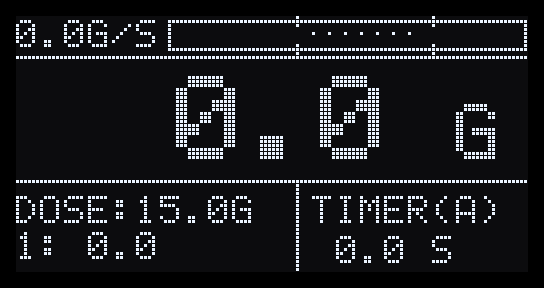
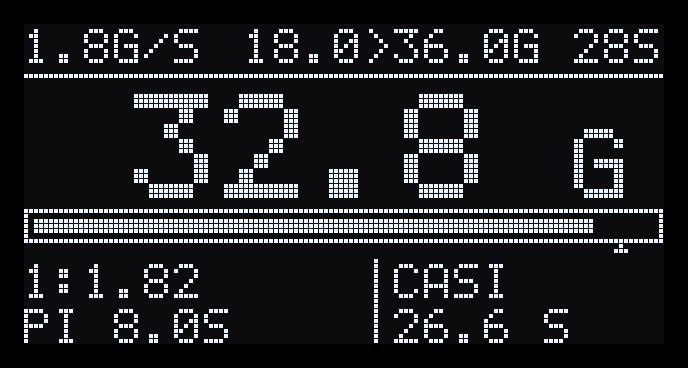
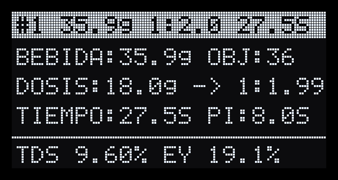
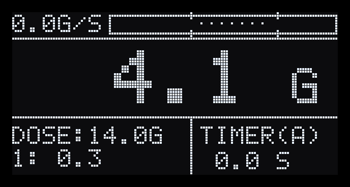
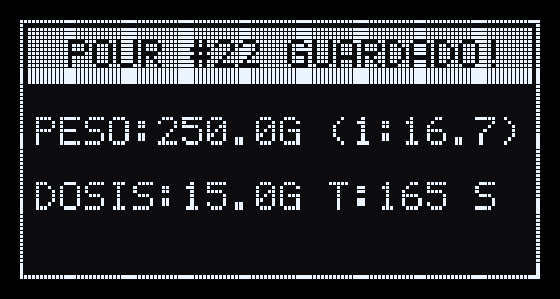
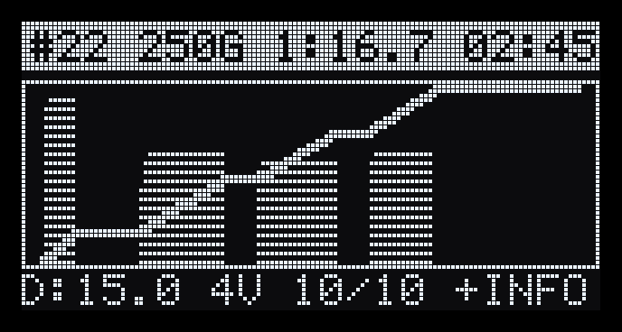
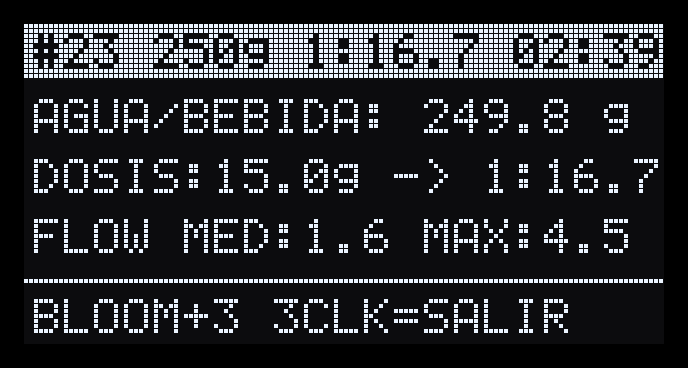

# Timemore Black Mirror Dot con pantalla, botones y conexión a la cafetera Wendougee

La **Timemore Black Mirror Dot** es una báscula de café preciosa y precisa, pero tiene dos pegas: no muestra el caudal ni tiene botones de cronómetro (todo va por la app del móvil), y las cafeteras **Wendougee** no la reconocen como báscula.

Este proyecto es un **pequeño aparato que se pone junto a la báscula** y resuelve las dos cosas:

1. **Le da a la Dot una pantalla y un mando.** Ves el peso, el caudal, el ratio y el tiempo sin sacar el móvil, y guarda tus últimas preparaciones de pour-over.
2. **Hace que la Wendougee acepte la Dot** como báscula, para preparar el espresso por peso.

Es un proyecto abierto: piezas fáciles de conseguir, una caja para imprimir en 3D y el programa listo para cargar.

## ¿Se puede usar la Timemore Dot con la Wendougee?

**Sí, con este aparato** (probado con una **Wendougee Lita BA**). Las Wendougee Lita, Lita BA y Data-S (con E-Bar o GeeFlow) solo aceptan básculas de la marca **BooKoo**, y la Timemore Dot no está en su lista.

El aparato hace de intermediario: recibe el peso de la Dot por Bluetooth y se lo pasa a la cafetera haciéndose pasar por una báscula BooKoo. Para la cafetera es como tener una BooKoo:

- **para el shot sola al llegar al peso** que le hayas marcado;
- **hace la tara y maneja el cronómetro** al empezar y al terminar;
- el peso llega al instante y **no se va retrasando con el uso**.

Además, la pantalla te dice cuánto sigue cayendo en la taza después de que la máquina pare, para afinar el peso objetivo.

**Cómo se activa:** en el aparato, *Menú → Puente BooKoo: ON*. En la cafetera, *Machine Settings → Connectivity → Smart Scale → ON → Scan* y elige la báscula `BOOKOO_SC_U …`. Paso a paso en el [manual](./MANUAL.md#35-puente-con-la-wendougee).

## Qué hace

- **Peso grande y claro**, con cuatro pantallas a elegir girando el mando: principal (caudal, dosis, ratio y tiempo), solo peso, barra de caudal y gráfica del caudal.
- **Medidor de caudal para pour-over** con la zona ideal marcada (3,5 a 7,5 g/s).
- **Dos modos, como la app de Timemore: pour-over y espresso.**
- **Pour-over:** tara y cronómetro con un clic; con el modo automático, el cronómetro arranca al empezar a verter y para al retirar la jarra. Reconoce el bloom.
- **Espresso:** receta configurable (dosis, ratio y tiempo), **preinfusión** (tiempo hasta la primera gota), barra de progreso hacia el peso objetivo y aviso para cortar a tiempo (en pantalla y con el LED), que aprende cuánto sigue cayendo tras cortar.
- **Historiales** de los 10 últimos pour-overs y los 10 últimos shots, con su gráfica y su ficha.
- **Puente para la Wendougee** (ver arriba).
- **Funciona con batería** recargable por USB-C, se atenúa y se duerme solo para ahorrar.
- **Se actualiza por Bluetooth desde el navegador**, con [una página web](https://jcallano.github.io/Timemore_Dot_OLED/ota/): sin cables ni programas.

Todo se explica en el **[manual de uso](./MANUAL.md)**.

## Así se ve

Un V60 completo, grabado de la propia pantalla del aparato y acelerado 10 veces: el cronómetro arranca solo al verter, el medidor marca el caudal y, al terminar, se guarda el resumen con su gráfica.

*Receta de ejemplo: 15 g de café y 250 g de agua, bloom de 45 g con 30 s de espera y tres vertidos. El peso es simulado (se inyecta en el aparato en lugar del de la Dot), pero todo lo demás es el firmware real funcionando.*

Y un espresso de 18 g a 36 g, acelerado 2 veces: clic al pulsar la cafetera, preinfusión, aviso `CASI` antes del punto de corte, corte, goteo y resumen del shot.

| Shot en marcha: aviso antes de cortar | Shot guardado |
| :---: | :---: |
|  |  |
| **Gráfica del shot** | **Ficha del shot** |
|  |  |

Capturas fijas del modo pour-over, sacadas de la memoria del aparato:

| Pantalla principal | Pour-over guardado |
| :---: | :---: |
|  |  |
| **Gráfica del pour-over** | **Ficha del pour-over** |
|  |  |

## Qué necesitas

| Pieza | Modelo |
| :--- | :--- |
| Placa | WeAct Studio ESP32-S3-A |
| Pantalla | OLED de 2,42" I2C (128×64) |
| Mando | Encoder giratorio EC11 con pulsador (módulo redondo) |
| Carga | Módulo TP4056 USB-C con protección |
| Batería | Celda 18650 con portapilas |
| Interruptor | Palanca MTS-103 |
| Caja | Impresa en 3D (PETG recomendado) |

Y, claro, una **Timemore Black Mirror Dot**.

## Cómo hacerlo

1. **Imprime la caja.** Los archivos y consejos de impresión están en [`cad/`](./cad/LEEME_caja.md).
2. **Conecta las piezas.** El esquema de conexiones (qué cable va a cada pin) está en la [documentación técnica](./docs/TECNICO.md#11-conexiones).
3. **Carga el programa** desde el IDE de Arduino: abre `firmware/firmware.ino` y súbelo a la placa por USB. Usa estas versiones, que son las probadas:

   | Programa / librería | Versión |
   | :--- | :--- |
   | Arduino IDE | 2.3.10 |
   | Core esp32 de Espressif | 3.3.12 (ESP-IDF 5.5.5) |
   | Librería NimBLE-Arduino (h2zero) | 2.5.2 |

   NimBLE-Arduino es la única librería que hay que instalar. Los ajustes de la placa están en la [documentación técnica](./docs/TECNICO.md#2-compilación).
4. **Enciéndelo con la Dot encendida.** La encuentra y se vincula solo.

## Documentación

- **[Manual de uso](./MANUAL.md):** controles, pantallas, preparación de pour-over, historial, puente con la Wendougee y solución de problemas.
- **[Documentación técnica](./docs/TECNICO.md):** conexiones, compilación, cómo funciona por dentro y estructura del código.

## In English

**Use a Timemore Black Mirror Dot scale with a Wendougee espresso machine.** Wendougee Lita, Lita BA and Data-S machines (E-Bar, GeeFlow) only accept BooKoo smart scales. This small open-source ESP32-S3 device connects to the Timemore Dot over Bluetooth and presents itself to the machine as a **BooKoo Themis Ultra**, so the machine can read the Dot's weight in real time, tare, run the timer and stop the shot by target weight. It also gives the Dot what it lacks: an OLED display with weight, flow rate, brew ratio and timer, a rotary knob, and two modes like the Timemore app. Pour-over mode has an auto-start/stop timer, bloom detection and a pour-over history. Espresso mode has a configurable recipe (dose, ratio, target time), pre-infusion time, a progress bar with a learned "cut now" alert and a shot history. 3D-printable case and Arduino firmware included (Arduino IDE 2.3.10, esp32 core 3.3.12, NimBLE-Arduino 2.5.2). Documentation is in Spanish.

## Licencia

[Creative Commons Reconocimiento 3.0 (CC BY 3.0)](https://creativecommons.org/licenses/by/3.0/): puedes usarlo, modificarlo y compartirlo, incluso para venderlo, siempre que **cites la fuente**:

> Basado en "Timemore_Dot_OLED" de jcallano (https://github.com/jcallano/Timemore_Dot_OLED), licencia CC BY 3.0.

Detalles en [`LICENSE`](./LICENSE).

Proyecto personal e independiente, sin relación con Timemore, BooKoo ni Wendougee. Sus nombres se usan solo para indicar con qué equipos es compatible.
