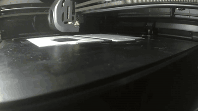
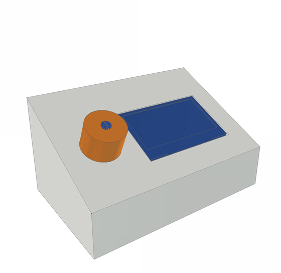
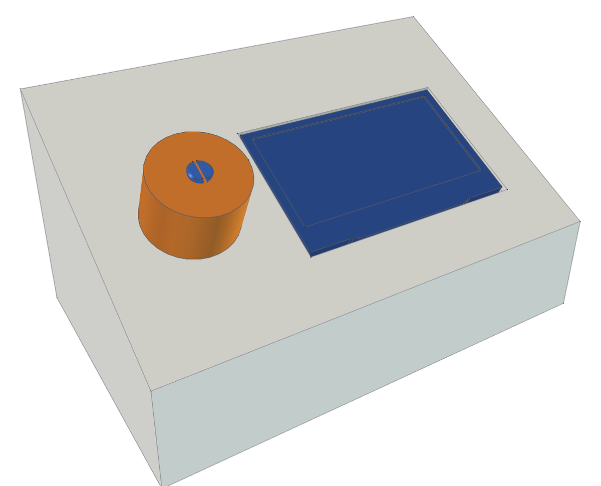
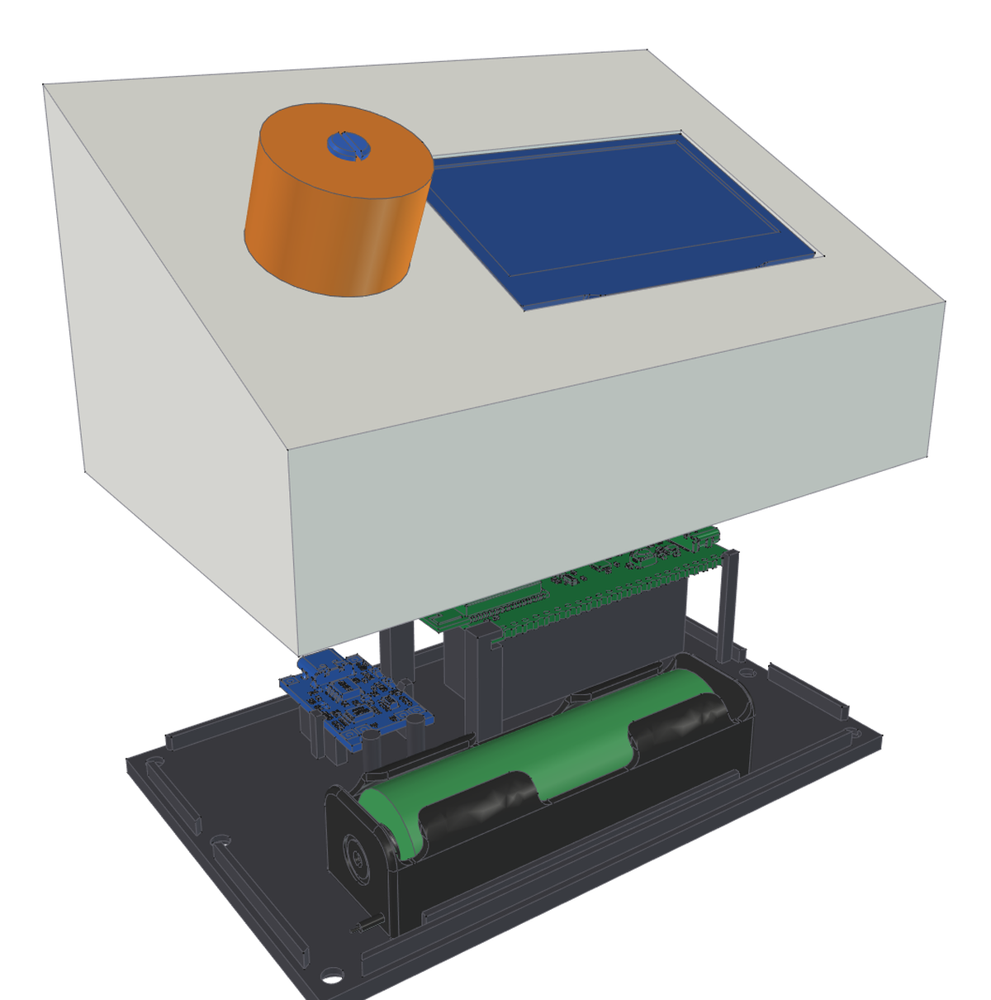
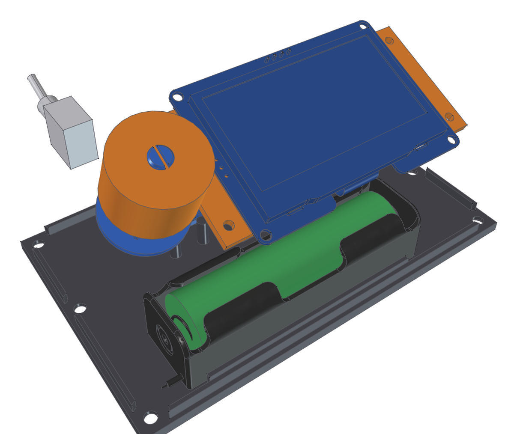
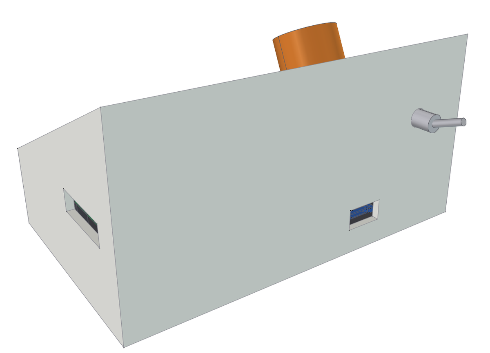

# Caja del display Timemore Dot

## Impresión real

*Timelapse de la impresión de la carcasa, acelerado ([vídeo en MP4](impresion/timelapse_impresion.mp4)). Pendiente: fotos del aparato impreso y montado.*

## Diseño

*La caja v2 con los modelos reales de los componentes ([vídeo en MP4](renders/animacion.mp4)).*

| Montado | Explosionado |
| :---: | :---: |
|  |  |
| **Interior (sin carcasa)** | **Trasera** |
|  |  |

## Archivos

- `caja_display_timemore.FCStd`: modelo paramétrico. Todo depende de la hoja **Parametros**: cambia un valor, pulsa Recompute y vuelve a exportar `Carcasa` y `Tapa`.
- `Carcasa.stl`, `Tapa.stl`, `PisadorOLED_izq.stl`, `PisadorOLED_der.stl`, `caja_display_timemore.step`: exportaciones para imprimir.
- `generar_caja.py`: regenera todo desde cero (`freecadcmd.exe generar_caja.py`). Al terminar comprueba los choques entre piezas, también contra los modelos reales de `ref_*/`.
- El grupo `Componentes_referencia` (oculto) contiene los volúmenes de los componentes y el portapilas real (IGES) para comprobar holguras. No se imprime.

## Distribución (vista desde delante)
- Cuña de 124 × 78 mm, 28 mm de alto delante y 64.4 mm detrás (incluida la tapa, que va encajada). El panel está inclinado 25°.
- **Panel**: el encoder a la izquierda (mano derecha libre para el kettle) y la OLED 2.42" a la derecha.
- **Delante, en la parte baja**: el portapilas 18650, a lo largo.
- **Detrás a la derecha**: el WeAct ESP32-S3-A, elevado 22 mm. Sus dos USB-C salen por el lateral derecho.
- **Detrás a la izquierda**: el TP4056. Su USB-C de carga sale por la pared trasera, y encima va el interruptor MTS-103.

## Detalles (v2, 24/11/2026; la v1 está en `respaldo_v1/`)
- **Encaje tapa-carcasa (cuna)**: la tapa va **dentro** de la carcasa. Las paredes (2.4 mm) llevan abajo un galce de 1.2 × 3 mm donde la tapa apoya en todo el perímetro y queda enrasada por debajo. Encima, la tapa lleva un labio de centrado de 1.2 × 3 mm pegado por dentro a las paredes (`reb_w`, `lip_t`, `lip_h`).
- **OLED 2.42" encajonada**: ventana de 63.5 × 40.5 mm (marco metálico de 63 × 40 medido + `clr`). El módulo entra en ella y el cristal queda 0.3 mm hundido (`oled_rec`). **Antes de montar, dobla 90° los 4 pines del header hacia el borde superior de la OLED (hacia la pared trasera), justo por encima del plástico**: así el dupont queda paralelo al panel y no baja sobre el ESP32. La OLED está 3 mm más abajo en la pendiente (`oled_s` = 37) para que los cables quepan antes de llegar a la pared trasera. La cara del PCB apoya en dos topes a los lados de la ventana, y el panel lleva un rebaje donde asoman por delante los pines del header.
  - **Sujeción**: dos **pisadores** impresos (`PisadorOLED_izq/der.stl`) aprietan el borde izquierdo y derecho del PCB por detrás, con 0.15 mm de precarga. Cada uno lleva 2 **tornillos M2.5 × 6** a **insertos de latón M2.5 × 3 × Ø3.5** (agujero de Ø3.4 × 3.5: la guía lisa de los insertos mide 3.0 y en FDM el agujero sale ~0.2 mm más estrecho; con Ø3.2 la guía no entraba) en 4 torretas que quedan fuera del PCB. No se usan los agujeros de la OLED: están a 1.25 mm del marco y el inserto no cabe ahí.
- **Encoder** (STEP ec11 v2): sin cambios. Agujero de Ø7.4 para la rosca M7, cuerpo apoyado en el panel de 2 mm y pines hacia la parte alta del panel.
- **WeAct ESP32-S3-A** (no tiene agujeros de montaje). Los pines y los dupont van **hacia abajo**, así que el PCB queda 22 mm sobre la tapa (`esp_lift`).
  - **Apoyo**: un bastidor central entre las dos filas de dupont.
  - **Lado de la antena**: una horquilla con ranura en las dos esquinas.
  - **Lado del USB**: dos ganchos de clip.
  - **Montaje**: mete primero el lado de la antena en la horquilla y luego baja el lado del USB hasta que encaje en los ganchos. La pared derecha hace de tope y los dos USB-C salen por una ranura lateral a la nueva altura.
- **TP4056** (pines **hacia arriba**, sin agujeros de montaje). Va 6 mm sobre la tapa (`tp_pad`), sobre dos carriles centrales que no tocan las soldaduras.
  - **Sujeción**: dos pivotes de Ø3.4 entran en sus muescas semicirculares y dos ganchos de clip lo sujetan por los bordes largos. La pared trasera hace de tope del USB-C, cuyo recorte sube con la placa.
- **Portapilas 18650**: sin cambios (carriles laterales + M3 desde debajo por su agujero central).
- **Interruptor MTS-103**: Ø6.4 en la pared trasera (x = 20, z = 40).
- **Cierre**: 5 postes con **insertos de latón M3 × 5 × Ø4.2** (agujero de Ø4.0 × 7, cabe un M3 × 6 o un M3 × 8). La tapa lleva pasos de Ø3.4 y cajeado para la cabeza.

## Pendiente
- Fotos de la caja impresa y el timelapse de la impresión (ver arriba).
- `Carcasa_USBC.stl` y su recorte manual en la pared trasera (x = 100, z = 31) quedan **obsoletos**: ahora el USB-C del ESP32 sale por el lateral.

## Medidas a verificar (típicas, no medidas)
Solo `aa_w`/`aa_h` (zona activa de 55 × 27.5 mm, la típica del 2.42"; el STEP no la trae, pero la ventana queda dentro del polarizador de 60 × 31.25 mm) y `bat_len` (largo de la celda, solo de referencia).

## Modelos reales usados para comprobar
- `ref_weact/WeAct_ESP32S3-A.step` (STEP oficial de WeAct, en GitHub)
- `ref_tp4056/TP4056_Charging_Module_Type_C.step`
- `ref_18650/portapilas_18650.iges`
- `ref_oled/OLED_2.42_IIC_v1.1.step`
- `ref_encoder/ec11_v2.step`

> **No están en el repositorio.** Son modelos de terceros (y pesan unos 31 MB). Descárgalos de sus autores y
> colócalos con esas mismas rutas. `generar_caja.py` funciona sin ellos (solo se salta las comprobaciones);
> `generar_ensamble.py` los necesita. Por la misma razón tampoco se incluyen `ensamble_display_timemore.FCStd`
> ni `ensamble_display_timemore.step` (101 MB, por encima del límite de GitHub): se regeneran con `generar_ensamble.py`.

Con todos colocados dentro de la caja no hay choques con la carcasa, la tapa ni los pisadores. Tampoco con los dupont, contando con los pines de la OLED doblados.

## Impresión (FDM, boquilla 0.4)
- **Carcasa**: imprímela apoyada sobre la **pared trasera**. Así el panel inclinado queda a 65° y se imprime sin soportes. Pon soportes solo bajo los postes de tornillo y las 4 torretas de la OLED (soportes "tree" desde la cama).
- **Tapa**: plana, con la cara lisa sobre la cama. Los ganchos y la horquilla salen sin soportes, aunque la ranura de la horquilla es un pequeño puente.
- **Pisadores**: planos, con el nervio hacia arriba.
- PETG recomendado (aguanta mejor el calor de los insertos y el vapor del kettle). Holgura de 0.25 mm por lado (`clr`).

## Ensamble (para ver cómo queda el producto)
- `ensamble_display_timemore.FCStd`: la carcasa, la tapa y todos los modelos reales en su sitio, con colores. Tiene dos grupos: **Montado** (visible) y **Explosionado** (oculto; la carcasa con la OLED, el encoder y el interruptor sube 45 mm, y la tapa con las placas baja 15 mm). En el árbol, pulsa la barra espaciadora sobre cada grupo para mostrarlo u ocultarlo.
- `ensamble_display_timemore.step`: el ensamble montado, para abrirlo en cualquier visor CAD.
- `generar_ensamble.py`: regenera los dos archivos anteriores. Ejecútalo **después** de `generar_caja.py` si cambias parámetros, porque es una copia estática. freecadcmd no guarda colores: están en `ensamble_colores.txt`.

## Renders y animación
Se hacen con el visor 3D de FreeCAD (iluminación y sombreado reales) a partir del ensamble:
1. `"C:Program FilesFreeCAD 1.1inreecad.exe" generar_renders.py` (con interfaz gráfica, no con freecadcmd). Abre una ventana de FreeCAD, aplica los colores, renderiza y se cierra sola. Deja las 4 vistas sin recortar en `renders/raw/` y 216 fotogramas de 1600 × 1200 en `renders/frames/` (ambas carpetas fuera del repositorio).
2. `node montar_renders.js` (necesita **ffmpeg** en el PATH). Recorta las vistas a su contenido (`renders/montado.png`, `explosionado.png`, `interior.png`, `trasera.png`, 1200 px) y monta la animación con un mismo recorte para todos los fotogramas: `renders/animacion.gif` (560 px, ~2,4 MB) y `renders/animacion.mp4` (1200 px, ~2,2 MB).

La animación: giro de 360° montado, explosionado, giro de 360° explosionado y vuelta a montar (9 s a 24 fps).
- El **mando** del encoder es un cilindro genérico de Ø24 × 16 mm, solo para ver proporciones; el de MakerWorld será distinto. El interruptor MTS-103 también está simplificado.
